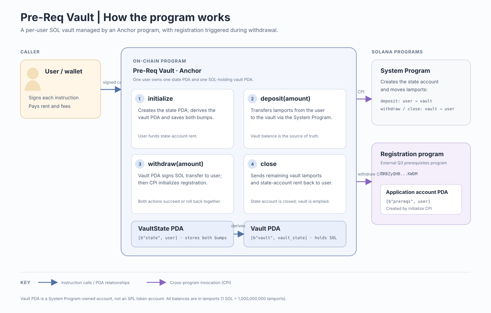

# Pre-Req Vault Architecture

## Overview

`pre-req-vault` is an Anchor program that holds SOL in a per-user PDA vault. A
user initializes the vault, deposits lamports, and can withdraw lamports. A
withdrawal also invokes the external Q3 prerequisites registration program to
initialize that user's application account. Closing the vault transfers its
remaining lamports to the user and closes the vault state account.

The repository contains the on-chain program and TypeScript integration tests;
it does not currently include a user-facing application.

## Architecture

The diagram summarizes how the user invokes the four instructions, how the
program's state and vault PDAs relate, and how the System Program and external
registration program participate in transfers and account creation.

## Accounts and instruction lifecycle

| Instruction | Main accounts | Behavior |
| --- | --- | --- |
| `initialize` | User signer, state PDA, vault PDA, System Program | Creates the state PDA at `[b"state", user]`, derives the vault at `[b"vault", vault_state]`, and stores both bumps in `VaultState`. The vault PDA is a System Program-owned account used to hold lamports; it is not an SPL token account. |
| `deposit(amount)` | User signer, state PDA, mutable vault PDA, System Program | Transfers `amount` lamports from the user to the vault through a System Program CPI. The state PDA constraint ties the vault to the signing user. |
| `withdraw(amount)` | User signer, state PDA, mutable vault PDA, application account PDA, registration program, System Program | Signs a System Program transfer from the vault PDA to the user with the vault PDA seeds, then invokes the registration program to initialize `[b"prereqs", user]`. The CPI currently passes the fixed string `"Worldkilas"` as its `github` argument. Both operations are part of the same Solana transaction; a failed CPI causes the transaction to fail atomically. |
| `close` | User signer, mutable state PDA, mutable vault PDA, System Program | Transfers the vault's full current lamport balance to the user, then Anchor closes the state PDA and refunds its rent to the user. |

`VaultState` contains only `vault_bump` and `state_bump`; it does not track
deposit history or an internal balance. The vault's lamport balance is the
source of truth for available funds.

## Repository map

- `programs/pre-req-vault/src/lib.rs` — program ID and public instruction
  dispatch.
- `programs/pre-req-vault/src/instructions/` — instruction account constraints
  and handlers for initialize, deposit, withdraw, and close.
- `programs/pre-req-vault/src/state.rs` — serialized `VaultState` account.
- `idls/registration.json` — external registration program interface used to
  generate the CPI bindings in `withdraw.rs`.
- `tests/pre-req-vault.ts` — TypeScript integration flow covering initialize,
  deposit, withdraw, and close.
- `Anchor.toml`, `Cargo.toml`, and `package.json` — Anchor/provider settings,
  Rust workspace configuration, and TypeScript tooling.

## Runtime and testing

- The Rust program uses Anchor (`anchor-lang` 1.1.2); the TypeScript tests use
  `@anchor-lang/core` and `@solana/web3.js`.
- `Anchor.toml` sets the provider cluster to devnet, skips the local validator,
  and configures the TypeScript test command. The configured wallet must be
  funded, and the external registration program must be available on the
  selected cluster for the withdrawal flow.
- Run the configured TypeScript suite with `anchor test`. The config also
  defines `anchor run testsvm` for `cargo test`.
- `programs/pre-req-vault/tests/test_initialize.rs` currently has its test
  implementation commented out, so it does not provide active Rust test
  coverage.

## Configuration notes

- The program ID declared in `programs/pre-req-vault/src/lib.rs` is
  `5HGxT8UThyiDLAEz6GZfFWzkiD72uHesDJKEaQdbVCAo`. The `[programs.localnet]`
  entry in `Anchor.toml` is instead
  `DBoobRVqT7PaAhq8obqo95723CHyWvcCLRUKvQ5wYWE4`; reconcile these IDs before
  using that localnet mapping.
- The TypeScript test derives PDAs using the program ID loaded from the
  workspace, and derives the registration account using the external program
  ID from the registration IDL.
- `constants.rs` and `error.rs` currently define counter-related values/errors;
  the vault instruction handlers do not use them.
